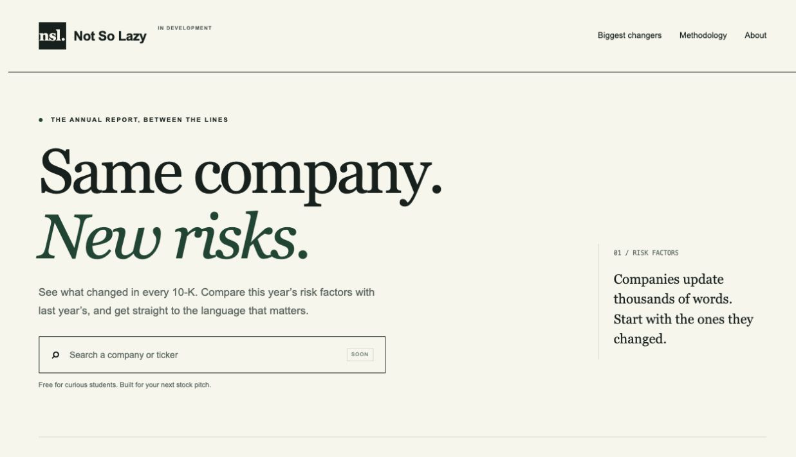

# Not So Lazy

**See what changed in every 10-K.** A free Risk Factors change tracker for students
and investment clubs, grounded in SEC EDGAR source filings.

## Status

Milestone 1: runnable scaffold. This is not the finished tracker. Ingestion,
real company comparisons, scores, summaries and deployment remain in later PRs.
The frontend deliberately shows an empty state instead of invented market data.



## Run locally

Requires Git, [uv](https://docs.astral.sh/uv/getting-started/installation/), and
Node.js 22 with npm. uv installs Python 3.12 as needed.

```sh
cp .env.example .env
cd pipeline
uv sync --locked
uv run nsl doctor
uv run nsl init-db
uv run alembic upgrade head
```

In another terminal, from the repository root:

```sh
cd web
npm ci
npm run dev
```

Open http://localhost:3000. Frontend data lives in `web/public/site/`; no keys
or backend are needed to preview. Keys must never use a `NEXT_PUBLIC_` prefix.

Before any future EDGAR request, set `SEC_USER_AGENT` in `.env` to
`NotSoLazy/0.1 your-real-contact@example.com`, then run
`uv run nsl doctor --require-sec` from `pipeline/`. Network stages will refuse
missing identity, throttle globally to <=8 req/s, and cache raw documents.

## Layout

- `pipeline/notsolazy/`: config, CLI, SQLAlchemy base and blob contract/local store.
- `pipeline/migrations/`: Alembic setup; stage migrations arrive with stage tables.
- `pipeline/tests/`: offline tests, fixture and golden-set directories.
- `web/`: Next.js App Router, TypeScript, Tailwind and static export.
- `docs/`: decisions, methodology, operations and milestone plan.
- `.github/workflows/ci.yml`: Python checks and frontend static build on PRs.

## Validate

```sh
cd pipeline
uv run ruff check .
uv run ruff format --check .
uv run mypy notsolazy
uv run pytest
```

From `web/` run `npm run lint`, `npm run typecheck`, and `npm run build`.

## Deployment plan

`npm run build` in `web/` writes `web/out/`. Vercel: set root directory `web`,
build command `npm run build`, output `out`. Cloudflare Pages: root `web`, build
`npm run build`, output `out`. No Next.js server, API routes or runtime secrets.
Publish precomputed JSON before rebuilding. R2 publishing, rebuild hooks, cron
and production deployment are Milestone 8 and are not configured yet.

Production state will use Postgres (Neon or Supabase) behind SQLAlchemy and R2
behind the blob interface. Summaries remain optional and provider-agnostic.

See [decisions](docs/DECISIONS.md), [runbook](docs/RUNBOOK.md),
[methodology](docs/METHODOLOGY.md), and [milestones](docs/MILESTONES.md).

Not investment advice. Data from SEC EDGAR. Not affiliated with the SEC.
