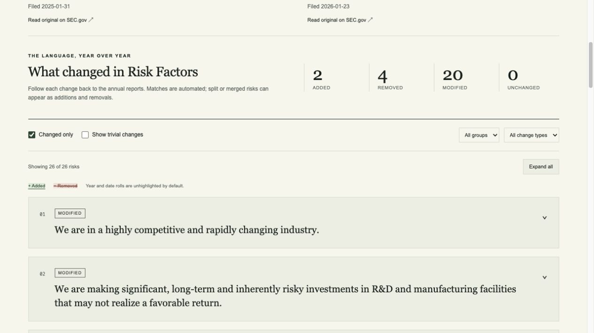

# Not So Lazy

**Read what changed in a company's annual Risk Factors.** A source-linked SEC
10-K comparison tool for students and investment clubs, with a reproducible
Python pipeline and a static Next.js reading interface.

[Live development preview](https://not-so-lazy-seven.vercel.app/) ·
[Documentation](docs/README.md) · [Roadmap and review stack](docs/PROJECT-STATUS.md) ·
[Contributing](CONTRIBUTING.md)

> **Development status — October 25, 2026.** Implementation is in stacked,
> unmerged milestone PRs. `main` is the project landing page; use
> [`docs-comprehensive-overview`](https://github.com/angelofernand0/not-so-lazy/tree/docs-comprehensive-overview)
> for the complete current source and documentation. The hosted preview may lag
> this branch; it is not a continuously refreshed or validated full-universe release.

## What works today

- Search 20 companies and inspect 40 annual filings: 19 comparisons are ready;
  GE Vernova is held for extraction review with original source links.
- Read side-by-side risk factors with sentence/word changes, added/removed labels,
  group and change filters, changed-only mode, expand/collapse and date-roll visibility.
- Discover annual filing pairs by CIK and report date, cache original SEC HTML,
  clean/extract Item 1A, segment factors, align them and export verified diff JSON.
- Reproduce an offline five-pair evaluation with frozen source hashes and labels.
  Intel's layout repair is covered by real-source regressions.

Scores, rankings, AI summaries, split/merge matching, scheduled publication and
full S&P 500 validation are **not implemented**. Automated matching labels describe
text correspondence; splits and merges can still look like additions/removals.



## Try the website locally

Requires Git and Node.js 22 with npm. The committed website snapshot needs no
Python, database, SEC identity, model download or API key.

```sh
git clone --branch docs-comprehensive-overview https://github.com/angelofernand0/not-so-lazy.git
cd not-so-lazy/web
npm ci
npm run dev
```

Open [localhost:3000](http://localhost:3000). Try `/c/AAPL/`, `/c/MSFT/`,
`/c/INTC/` and `/c/GEV/` (review state). `npm run build` creates `web/out/`;
the exported pages and JSON can be served by a static host without a Next.js server.

## Run the parsing pipeline

Also requires [uv](https://docs.astral.sh/uv/getting-started/installation/), which
can provision Python 3.12. From the repository root:

```sh
cp .env.example .env
cd pipeline
uv sync --locked
uv run nsl doctor
uv run nsl init-db
```

`init-db` applies Alembic migrations. SQLite and local blobs are the development
defaults; CI also checks migrations against Postgres 17. Commands below run from
`pipeline/`, where relative data paths and the root `.env` resolve correctly.

Before EDGAR access, set `SEC_USER_AGENT` in the root `.env` to
`NotSoLazy/0.1 your-real-contact@example.com`, replacing the example contact.
Keep the real contact and credentials out of Git. Then process one company:

```sh
uv run nsl doctor --require-sec
uv run nsl discover --ticker AAPL
uv run nsl fetch --ticker AAPL
uv run nsl clean --ticker AAPL
uv run nsl extract --ticker AAPL
uv run nsl model prepare
uv run nsl segment --ticker AAPL
uv run nsl align --ticker AAPL
uv run nsl diff --ticker AAPL
uv run nsl review list
uv run nsl preview --tickers AAPL --output ../web/public/site
```

The last command replaces the exporter's managed snapshot with the explicit
ticker selection. Use the [20-company command in the runbook](docs/RUNBOOK.md#local-company-preview)
to retain the development preview's coverage. Rebuild the website after exporting.

`discover`/`fetch` use EDGAR; `model prepare` explicitly downloads a pinned MiniLM
model from Hugging Face. Cleaning, extraction, segmentation, alignment, diffs
and preview export then run offline. Missing inputs fail visibly rather than
triggering hidden downloads. Quality flags block comparison/export; resolving a
review note does not bypass those checks.

The committed universe snapshot has 503 tickers for 500 issuers. Refresh it with
`uv run nsl universe refresh`. Omitting `--ticker` processes the discovered
universe, so start with an explicit ticker. Network workers must share `DATA_DIR`
to share the rate limiter, capped at eight requests per second. See the
[runbook](docs/RUNBOOK.md) for cache recovery, amendments and stage invalidation.

## Measured quality and current limits

The five-pair development pilot covers AAPL, MSFT, HON, INTC and O: ten filings
and 262 reference risk starts. With extraction/segmentation v3, measured results
are 10/10 passing section-boundary checks, 262 correct / 0 extra / 0 missed risk
starts, and 123 correct / 0 false / 5 missed continuity edges. Four false additions
and two false removals remain, alongside two excluded, unresolved endpoints.

These labels are agent-reviewed, used during development, and neither independently
human-adjudicated nor held out. They do not establish exact factor-body boundaries,
word-diff correctness, economic significance or population accuracy. Read the
[full results](docs/EVALUATION-INTEL-FIXED.md),
[unchanged pre-fix baseline](docs/EVALUATION-PILOT.md) and
[next evaluation work](docs/EVALUATION-NEXT.md).

Reproduce extraction/segmentation checks without a database or downloaded model:

```sh
# From pipeline/; write new output rather than overwrite the historical reports.
uv run nsl evaluate --manifest tests/golden/pilot.json \
  --extraction-only --output data/evaluation-extraction.json
```

For continuity metrics, first run `uv run nsl model prepare`, then omit
`--extraction-only`; optionally add `--report data/evaluation.md`. Known remaining
errors mean the full pilot is not yet a zero-error acceptance gate.

## Architecture

```text
SEC EDGAR → discover/pair → immutable raw HTML
  → cleaned blocks → Item 1A + quality review → risk factors
  → exact/fuzzy/local embedding alignment → sentence/word diff
  → verified static JSON → Next.js export → browser
```

The browser reads same-origin precomputed JSON, verifies its hash and Unicode
span coverage, and never calls EDGAR or an LLM. SQLAlchemy records stage metadata;
local blobs retain source evidence and versioned outputs. Code/input/model
signatures reject stale artifacts. See [architecture](docs/ARCHITECTURE.md) and
[methodology](docs/METHODOLOGY.md) for contracts and limitations.

## Checks

From `pipeline/`:

```sh
uv run ruff check .
uv run ruff format --check .
uv run mypy notsolazy
uv run pytest
```

From `web/`: `npm run lint`, `npm run typecheck`, `npm run test`, `npm run build`.
The Intel repair passed 147 Python tests, six frontend tests, lint/type checks and
the static build. [CI](https://github.com/angelofernand0/not-so-lazy/actions)
also verifies Postgres migrations; see [verification evidence](docs/INTEL-VALIDATION.md).

## What to work on next

1. Add bounded split/merge matching and rerun the frozen pilot, preserving ambiguous cases.
2. Independently adjudicate labels, expand to 30 diverse pairs and reserve a held-out subset.
3. Implement and validate change scores before a pilot leaderboard or full backfill.
4. Add optional quote-verified summaries, then automate publication and deployment.

Acceptance criteria and the complete PR dependency chain are in
[project status](docs/PROJECT-STATUS.md). Start with the [documentation index](docs/README.md)
for operations, design decisions, evaluation evidence and contributor guidance.

Not investment advice. Data from SEC EDGAR. Not affiliated with the SEC.
